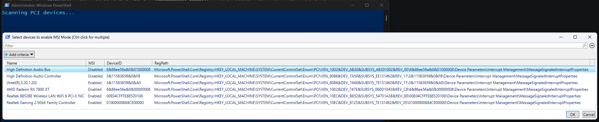

<div align="center">

# MSI Mode Utility

**Check MSI mode in 10 seconds. Enable it in one click. We measured what it fixes, and what it doesn't.**

An open-source PowerShell script to view and toggle **MSI (Message Signaled Interrupts) mode** for PCI devices on Windows 10/11 — a transparent alternative to the closed-source "MSI Util v3" `.exe` from forum threads.
Zero install. Zero dependencies. Built-in undo.

[](https://github.com/vadyaravadim/msi-mode-utility/actions/workflows/ci.yml)
[](LICENSE)
[](https://www.microsoft.com/windows)
[](https://docs.microsoft.com/en-us/powershell/)
[](https://github.com/vadyaravadim/msi-mode-utility/releases)
[](https://www.powershellgallery.com/packages/msi-mode-utility)
[](https://github.com/vadyaravadim/msi-mode-utility/stargazers)

**[Read the deep dive with measured before/after traces →](https://rigpolice.com/system/articles/enable-msi-mode/?utm_source=github&utm_medium=readme&utm_campaign=msi-mode-utility)**

**Part of the [RigPolice Latency Toolbox](https://rigpolice.com/system/latency-toolbox/?utm_source=github&utm_medium=readme&utm_campaign=msi-mode-utility) — check your mouse's real polling rate after the change with the free [Polling Rate Test](https://rigpolice.com/mouse/tests/polling-rate-test/?utm_source=github&utm_medium=readme&utm_campaign=msi-mode-utility)**

If it works for you, a ⭐ helps others find it.

</div>

---



## Quick Start

**Easiest — one line, in any PowerShell** (it self-elevates):

```powershell
irm https://github.com/vadyaravadim/msi-mode-utility/releases/latest/download/msi-mode-utility.ps1 | iex
```

The script downloads itself to `%USERPROFILE%\msi-mode-utility.ps1` (not a temp folder) on purpose: the `msi_undo_*.reg` rollback file is written next to it and must survive automatic temp cleanup. An existing copy at that path that differs is kept as `.bak`. The `irm | iex` pipe itself takes no switches - run the saved copy instead, see [Optional switches](#optional-switches).

**Check it before it runs:** download `msi-mode-utility.ps1` from the [latest release](https://github.com/vadyaravadim/msi-mode-utility/releases/latest), verify it as [SECURITY.md](SECURITY.md#verifying-a-release) shows, then run that file with `powershell -ExecutionPolicy Bypass -File .\msi-mode-utility.ps1`.

**From the PowerShell Gallery**, in PowerShell 7 (`pwsh`):

```powershell
Install-Script msi-mode-utility
msi-mode-utility                     # then run it by name (open a NEW PowerShell window first, so the Scripts folder is on PATH)
msi-mode-utility -ShowAll            # switches work directly: -ShowAll, -Disable, -Status
```

The script self-elevates. Update later with `Update-Script msi-mode-utility`. Not in the Windows PowerShell 5.1 that comes with Windows: there `Install-Script` wants an admin console and the default execution policy blocks the installed script — use the one-liner instead.

**Or clone:**

```powershell
git clone https://github.com/vadyaravadim/msi-mode-utility.git
cd msi-mode-utility
.\Run.bat
```

**Or download the ZIP** (no PowerShell needed): click **Code ▸ Download ZIP** at the top of this page, unzip, then double-click **`Run.bat`**.

### Using the picker

However you launch it:

1. Click **Yes** on the UAC prompt (the script requests admin rights on its own).
2. In the grid window, `Ctrl`-click the devices you want, then click **OK**.
3. **Reboot.**

### Optional switches

| Switch | Effect |
| --- | --- |
| `-ShowAll` | Show every PCI device with an Interrupt Management key, including the storage controllers and bridges hidden by default. Picking a storage controller asks first |
| `-Disable` | Turn MSI **off** for the selected devices |
| `-Status` | Print the device list with the interrupt mode each device actually runs in. Changes nothing, needs no admin rights |

How to pass a switch depends on how you got the script:

| Installed via | Command |
|---------------|---------|
| PowerShell Gallery (PowerShell 7) | `msi-mode-utility -ShowAll` |
| ZIP or clone | `.\Run.bat -ShowAll` from the script's folder |
| One-liner | `powershell -ExecutionPolicy Bypass -File "$env:USERPROFILE\msi-mode-utility.ps1" -ShowAll` |

Calling `.\msi-mode-utility.ps1` directly only works if your execution policy allows scripts — Windows blocks them by default, which is what `Run.bat` and `-ExecutionPolicy Bypass` get around.

## What It Does

1. **Scans** PCI devices and shows the latency-critical ones (GPU, network, USB, audio) in a grid with their `MSISupported` setting and the interrupt mode each one actually runs in: `MSI`, or `Line IRQ n` plus whoever shares that line
2. **Backs up** the previous state of every selected device to a timestamped `msi_undo_*.reg` file next to the script (in `%USERPROFILE%` when run via the one-liner) — **before** changing anything
3. **Enables MSI mode** for the devices you selected (sets the documented `MSISupported` registry value)

Rollback = double-click the undo file, then reboot. No System Restore needed, and it works from Safe Mode for any device except the controller of your boot drive (see [Disclaimer](#disclaimer)).

## The Problem: Line-Based (IRQ) vs Message Signaled Interrupts

Legacy line-based (IRQ) interrupts share physical lines, so a device can be forced to wait or collide with others. MSI lets a device signal the CPU by writing to a memory address instead, so each device gets its own vector. Windows still leaves some devices in legacy mode even when their driver supports MSI. On our Windows 11 testbed that was both audio controllers. Windows' own HD Audio driver writes 0 for them, so they shared one line.

**Where guides say it helps** (what we measured is in the [FAQ](#does-enabling-msi-mode-reduce-input-lag-or-increase-fps)):

- A device sharing a legacy IRQ line with a busy neighbor. Guides name audio popping or crackling under GPU or USB load as the classic case. igor'sLAB reports crackling under full GPU load on the author's own PC, where HD Audio ran on legacy lines twice, and it stopped after the switch to MSI. We haven't measured crackling
- DPC latency spikes that trace back to a driver on a shared line, as guides describe them (msinfo32 shows who shares with whom, see [Verify](#verify-check-if-msi-mode-is-enabled)). We haven't measured spikes
- Older platforms and add-in cards (sound, USB, capture) that Windows left in line-based mode

**What it won't do:** change anything for a device that already runs MSI. So the script shows you the current state first. On a modern PC the answer is often "already on".

## Requirements

| | |
|---|---|
| **Windows** | 10, 11 |
| **PowerShell** | Windows PowerShell 5.1 (ships with Windows 10/11); PowerShell 7 works too. Uses `Out-GridView`, which both have on Windows editions with a desktop. Windows Server Core is **not** supported: the script says so and stops before the scan, changing nothing; `-Status` works there too |
| **Rights** | Administrator (the script self-elevates via UAC); `-Status` needs none |

## How It Works

The MSI flag lives at:

```
HKLM\SYSTEM\CurrentControlSet\Enum\PCI\<class>\<instance>\Device Parameters\Interrupt Management\MessageSignaledInterruptProperties
    Value: MSISupported  (DWORD)   1 = MSI on, 0 = off
```

Per Microsoft Learn, a driver's INF creates the `MessageSignaledInterruptProperties` key when its `AddReg` section adds the `MSISupported` value. A device whose INF wrote nothing has no such value, so the script creates the key and value as needed rather than only flipping existing ones.

When the value is absent, the grid shows **Default** (not "Disabled"): it means no INF or tool wrote the value. Microsoft requires a driver's INF to set it before a device can receive MSIs. The **Mode** column shows what each device runs in.

## Verify: Check If MSI Mode Is Enabled

After the reboot, confirm the device actually runs in MSI mode:

- **Device Manager** → device → **Properties ▸ Resources**: a **negative IRQ number** (e.g. `-59`) means message-signaled interrupts are active; a small positive number means legacy line-based mode.
- **msinfo32** → Hardware Resources ▸ IRQs: legacy devices sit at the top on small numbers (two devices on the same number share that line); MSI/MSI-X devices sit at the bottom, where msinfo32 prints the negative IRQ as a ten-digit number such as `IRQ 4294967255`.
- Or run the script with `-Status` (no admin rights needed): the **Mode** column shows what each device runs in this boot — `MSI`, or `Line IRQ n` plus whoever shares that line.

## Reverting

Two options:

1. Double-click the `msi_undo_*.reg` file created before your change, then reboot (restores the previous `MSISupported` state; works from Safe Mode for any device except the controller of your boot drive, see [Disclaimer](#disclaimer)). If you ran the script several times against the same device, apply the undo files newest-to-oldest — each one is a snapshot of the state before *that* run, so only the oldest holds the original state.
2. Run the script again with `-Disable` (`.\Run.bat -Disable` from a ZIP or clone; [other install methods](#optional-switches) pass the switch differently) and select the same devices. Note: this writes an explicit `MSISupported = 0`; if the device originally had no `MSISupported` value at all (shown as **Default** in the grid), only the undo file restores that exact state.

Prefer a System Restore point anyway? It is the easy way back if you change a storage controller. Create one yourself before running: `Checkpoint-Computer -Description "Before MSI"` (note: Windows silently skips it if a point was made within the last 24 hours).

## FAQ

### What is MSI mode?

MSI (Message Signaled Interrupts) is a way for a PCI/PCIe device to deliver interrupts by writing to a memory address instead of asserting a shared physical IRQ line. With its own vector, a device stops running its routine for a neighbor's interrupt.

### Does enabling MSI mode reduce input lag or increase FPS?

A little, where a shared line was left. We have not measured input lag: that takes an end-to-end instrument (a Reflex Analyzer, LDAT or a photodiode), and interrupt or frame times are not input lag. What we measured on an i9-14900F / RX 7800 XT desktop (Windows 11 26H2, Memory Integrity on), 8 clean boots per state, Unigine Superposition at 1440p (GPU-bound, about 120 fps) plus an audio tone and back-to-back USB SSD reads in every run:

| Change | Interrupt cost | Frames, median of 8 runs |
|--------|----------------|--------------------------|
| Two audio controllers, shared IRQ 17 → MSI (what this script changes on that PC) | Routine calls 228/s → 114/s for 114 interrupts; the calls move from CPU 0 to CPU 1 | **+0.6% average fps** (120.0 → 120.7), 1% low 9.04 → 8.76 ms; all 8 MSI runs beat all 8 stock runs |
| GPU, MSI → forced legacy line (ceiling) | Mean ISR 21.1 µs both ways; DPC p99 8.5 → 116 µs | No loss: 121.4 fps, above stock, which we cannot explain |
| USB xHCI at ~8,000 interrupts/s, MSI → forced legacy line (ceiling) | Mean ISR 0.18 → 1.11 µs, mean DPC 2.5 → 3.4 µs | Unchanged (120.2 fps) |

MSI mode removes one specific cost. When two devices share an interrupt line, Windows calls their routines in turn until a driver claims the interrupt, so a device can run its routine for its neighbor's interrupts. Windows 11 drivers had already put the GPU, USB, NVMe and network devices in MSI/MSI-X on that machine. The only legacy devices were the two audio controllers. On the igor'sLAB PC above, the sound crackled under full GPU load until HD Audio moved to MSI. **[The RigPolice article](https://rigpolice.com/system/articles/enable-msi-mode/?utm_source=github&utm_medium=readme&utm_campaign=msi-mode-utility)** has the full method, the charts and a guide to checking your own PC in 30 seconds. Run the same measurement on your own machine with [`bench/msi-bench.ps1`](bench/msi-bench.ps1) (NT Kernel Logger + `tracerpt`, PresentMon for frames). The public bench repeats the trace, the probes and the frame capture. The public bench also runs the same audio tone and SSD reads (`-Background tone,usb-read -UsbReadFile <path>`). The raw output of all 32 runs is in [`bench/results/`](bench/results/).

### Is it safe to enable MSI mode?

`MSISupported` is a documented, reversible registry value. Before every change the script saves a `.reg` undo file with the previous state of the values it changes. Worst case, a device that misbehaves with MSI reverts as soon as you apply the undo file and reboot, from Safe Mode if need be. The exception is the controller of your boot drive: if it fails, Windows may not start at all, Safe Mode included, and the [Disclaimer](#disclaimer) says how to recover. That is why storage controllers are hidden by default and the script asks before it changes one.

### Should I enable MSI mode for my NVIDIA or AMD GPU?

Read the **Mode** column first. If it says `Line IRQ …`, enabling MSI is a cheap, reversible step. If it says `MSI`, there is nothing to change: our RX 7800 XT ran in MSI mode out of the box.

### What is the difference between MSI and MSI-X?

MSI-X is the newer extension of MSI with more interrupt vectors and better CPU distribution. Devices already running in MSI-X mode don't need this tweak. NVMe drives are hidden by default for that reason; GPUs are still shown because whether they use MSI/MSI-X depends on the driver.

### How is this different from MSI Util v3 (MSI Mode Utility)?

MSI Util v3 is a closed-source `.exe` passed around via forum threads. This is a readable, open-source PowerShell script that flips the same documented registry value — but it also filters the list down to latency-critical devices, writes a `.reg` undo file before every change, and leaves no binary on your system. Use whichever you prefer — this is the transparent, scriptable option.

### Where are my NVMe drives?

Hidden by the default filter on purpose: NVMe uses MSI-X out of the box, so there is nothing to gain. Use `-ShowAll` if you want to see them anyway. The script asks before it changes a storage controller: if it runs your boot drive, a failure can stop Windows from starting.

### How do I re-enable the old interrupt mode?

Double-click the `msi_undo_*.reg` file saved next to the script (or in `%USERPROFILE%` if you used the one-liner) — see [Reverting](#reverting).

### Does disabling MPO (Multiplane Overlay) help with flickering and stutters?

MPO is a DWM display feature, not an interrupt setting, but it shows up in the same troubleshooting threads: on some GPU/driver combinations it causes flickering, black screens, or stutter in windowed games. NVIDIA's support article gives DWORD `OverlayTestMode = 5` under `HKLM\SOFTWARE\Microsoft\Windows\Dwm` as the registry value that turns MPO off (delete it to revert). There's no MPO disabler in this series. If you see these symptoms, update your GPU driver first.

### How do I remove the script itself?

Apply the `msi_undo_*.reg` files first if you want the old interrupt modes back (see [Reverting](#reverting)). Then delete what the script left: with the one-liner, `msi-mode-utility.ps1`, an `msi-mode-utility.ps1.bak` if there is one, and the `msi_undo_*.reg` files in `%USERPROFILE%`; with the ZIP or a clone, the folder. From the PowerShell Gallery, the undo files sit in the folder `(Get-InstalledScript msi-mode-utility).InstalledLocation` prints; delete them, then run `Uninstall-Script msi-mode-utility`. The script installs nothing else.

## Related

- [Interrupt Affinity Utility](https://github.com/vadyaravadim/interrupt-affinity-utility) — pin GPU, network, USB & audio interrupts to specific CPU cores (P/E-core aware) — the natural next step after enabling MSI mode
- [CPU Parking Disabler](https://github.com/vadyaravadim/cpu-parking-disabler) — disable CPU core parking on Windows 10/11, with the parked-core count shown before and after
- [Timer Resolution Utility](https://github.com/vadyaravadim/timer-resolution-utility) — set 0.5 ms timer resolution, disable dynamic tick, un-force HPET — with a built-in Sleep(1) benchmark
- [GameDVR & FSO Disabler](https://github.com/vadyaravadim/gamedvr-fso-disabler) — disable Game DVR / Xbox Game Bar capture and Fullscreen Optimizations on Windows 10/11
- [Remove Hidden Devices](https://github.com/vadyaravadim/remove-hidden-devices) — remove ghost / hidden devices left behind by unplugged USB sticks, headsets & dongles cluttering Device Manager

Same idea across the series: one transparent PowerShell script, no binaries, you see exactly what changes.

## Disclaimer

Editing interrupt settings can, in rare cases, cause a device to fail to start. For most devices, applying the undo file and rebooting fixes it, from Safe Mode if need be. The controller of your boot drive is the exception: if it fails in the new mode, Windows may not start at all, Safe Mode included. Then boot into the Windows recovery environment and use System Restore, or open regedit there, load `Windows\System32\config\SYSTEM` from the Windows drive (File > Load Hive) and set `MSISupported` back in the control set that `Select\Current` names (usually `ControlSet001`), under `Enum\<device>\Device Parameters\Interrupt Management\MessageSignaledInterruptProperties`. Create a restore point before you change a storage controller. Use at your own risk.

## License

[MIT](LICENSE) — use at your own risk.

---

<div align="center">

If this helped, consider giving it a ⭐

[Report Issues](https://github.com/vadyaravadim/msi-mode-utility/issues)

</div>
